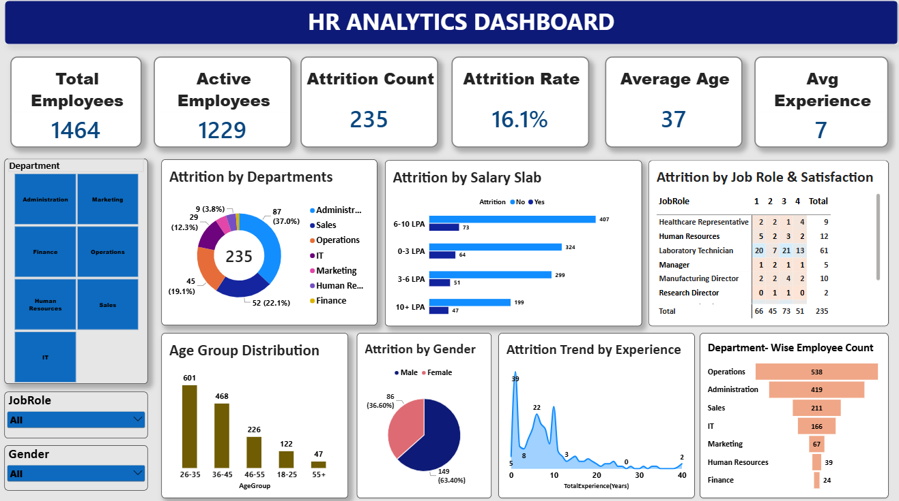

# HR Analytics Dashboard | Power BI

## 📌 Project Overview

This project focuses on analyzing Human Resource (HR) data using Microsoft Power BI to identify employee attrition patterns, understand workforce demographics, and provide insights into employee distribution across departments.

An interactive HR Analytics Dashboard was developed to help HR professionals monitor key workforce metrics and explore factors associated with employee attrition.

## 🖼️ Dashboard Preview

## 🎯 Project Objectives

- Analyze overall employee attrition and retention.
- Identify departments with higher employee attrition.
- Understand attrition patterns across different salary groups.
- Analyze employee demographics based on age and gender.
- Explore the relationship between employee experience and attrition.
- Monitor employee distribution across departments and job roles.

## 🛠️ Tools & Technologies

- Microsoft Power BI
- Power Query – Data Cleaning and Transformation
- DAX – Calculated Measures and KPI Development
- Data Visualization

## 📊 Key Performance Indicators (KPIs)

| KPI | Value |
|---|---:|
| Total Employees | 1,464 |
| Active Employees | 1,229 |
| Attrition Count | 235 |
| Attrition Rate | 16.1% |
| Average Age | 37 |
| Average Experience | 7 |

## 📈 Dashboard Features & Visualizations

1. **Attrition by Department** – Analyzes employee attrition across different departments.
2. **Attrition by Salary Slab** – Examines attrition patterns across different salary categories.
3. **Attrition by Job Role & Satisfaction** – Explores job roles alongside employee satisfaction ratings.
4. **Age Group Distribution** – Analyzes employee distribution across different age groups.
5. **Attrition by Gender** – Compares employee attrition between male and female employees.
6. **Attrition Trend by Experience** – Examines attrition patterns based on years of work experience.
7. **Employee Count by Department** – Displays employee distribution across departments.

## 🎛️ Interactive Features

The dashboard includes interactive slicers for:

- Department
- Job Role
- Gender

These slicers allow users to explore the data from different perspectives and analyze workforce trends dynamically.

## 🧮 DAX Measures

DAX was used to create measures for key workforce KPIs and dashboard analysis, including:

- Total Employees
- Active Employees
- Attrition Count
- Attrition Rate
- Average Age
- Average Experience

## 💡 Key Business Questions

- What is the overall employee attrition rate?
- Which departments experience higher employee attrition?
- Which salary categories have higher attrition?
- How does employee attrition differ by gender?
- How are employees distributed across different age groups?
- How does attrition vary according to work experience?
- Which departments have the highest employee population?

## 🚀 Conclusion

This project demonstrates the application of Power BI in HR analytics through interactive dashboard development, KPI monitoring, DAX calculations, and data visualization.

The dashboard provides an overview of workforce demographics and employee attrition patterns, helping HR professionals explore employee trends and make data-informed decisions.

---

**Developed using Microsoft Power BI**
